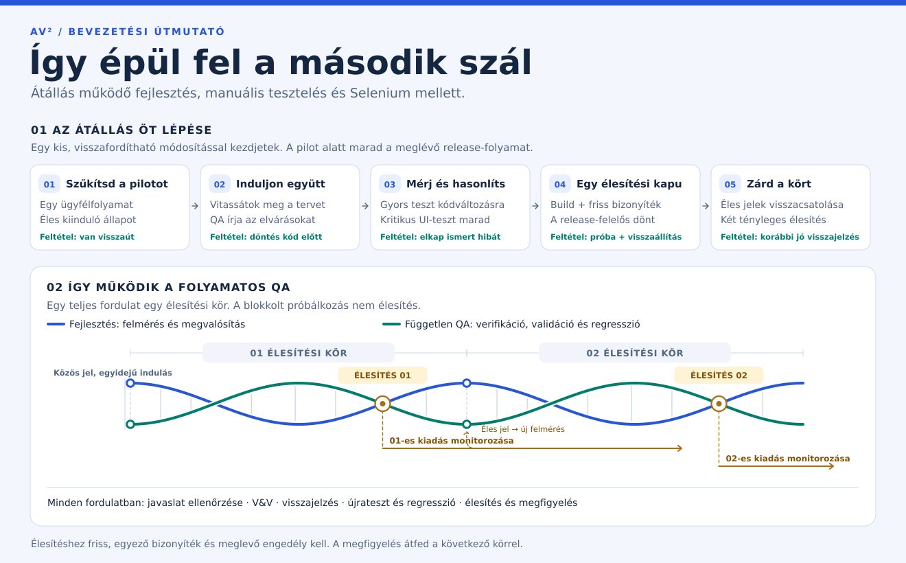

# AV² bevezetési útmutató · Hogyan álljon át egy meglévő csapat?

**Hétfőn ennyit csináljatok:** válasszatok ki egy kis, visszafordítható módosítást egyetlen ügyfélfolyamatban. A fejlesztő és a QA ugyanazt a megfigyelést ugyanakkor kapja meg. A QA már az első kódváltozat előtt kérdőjelezze meg a javaslatot, írjon két önálló elfogadási példát, és legyen joga jelezni, hogy az adott változás nem áll készen. A fejlesztési folyamatot és a meglévő release-szabályokat egyelőre hagyjátok érintetlenül.

## Öt lépés, mindegyikhez továbblépési feltétellel

1. **Szűkítsétek a pilotot.** A QA vezető, a termékfelelős és az üzemeltetés válasszon egy mérhető, tesztelhető felhasználói folyamatot. Rögzítsétek a most éles verziót, a hibákat, a QA visszajelzési idejét és a visszaállítás módját. Tegyetek félre olyan első pilotot, amely visszafordíthatatlan, vagy érzékeny adatokat igényel. **Akkor lépjetek tovább**, ha világos a felelős, az üzleti cél, a kiinduló állapot és a visszaút. Ha az élesítés nem ismételhető biztonságosan, induljatok tesztkörnyezetben.
2. **Indítsátok el a két szálat egyszerre.** Egy jól dokumentált üzleti jelhez rendeljetek fejlesztőt és független QA-felelőst. A jegyben legyen az éles alapverzió, a forrásjel, a cél, a megőrzendő szabályok, a függőségek és a kockázat. A QA ellenőrizze a jel hitelességét, vitassa meg az üzleti hasznot, keressen ütközést más fejlesztéssel vagy szabállyal. A saját elfogadási példáit az első érintett kód előtt rögzítse. **Akkor lépjetek tovább**, ha már kódírás előtt látszik legalább egy tényleges QA-döntés. A fejlesztő ne hagyhassa jóvá a saját kritikus tesztbizonyítékát.
3. **Futtassatok korai, gyors ellenőrzéseket, eleinte csak megfigyelő módban.** Az érdemi kódváltozásokra fusson statikus ellenőrzés, majd az érintett modult vagy API-t próbáló teszt. A konkrét hibát újra kell tesztelni, és külön futtatni kell az érintett regressziót. A Selenium maradjon azokon az útvonalakon, ahol valódi böngészőviselkedést kell bizonyítani. Maradjon manuális feltáró teszt és a meglévő release-kapu is. **Akkor lépjetek tovább**, ha a gyors teszt a jó jelöltet átengedi, a szándékosan hibás tesztváltozatot a megfelelő okból elkapja, és az új verzión újrafut.
4. **Hozzátok létre az élesítési találkozópontot.** A fejlesztő hozza a konkrét kiadásra jelölt buildet, a QA az arra a verzióra vonatkozó független bizonyítékot, a jelenlegi release-felelős pedig meghozza az élesítési döntést. Hiányos, hibás vagy régi bizonyítéknál az érintett változás áll meg, nem az egész csapat. Egy új build nem örökli az előző zöld eredményét: ami érintett, azt újra kell ellenőrizni. **Akkor próbáljátok ki élesben**, ha tesztkörnyezetben bemutattátok az átengedést, a blokkolást és a visszaállítást. Az első éles kör legyen szűk és ember által engedélyezett.
5. **Kapcsoljátok vissza az éles jeleket.** Előre határozzátok meg, mit figyeltek, ki figyeli, és mikor állítjátok vissza a módosítást. Az előző kiadás monitorozása alatt már indulhat a következő kör felmérése és független QA-ja, a legutóbbi éles verzióból. Az éles jel új jegyet nyithat vagy átrendezheti a prioritást; önmagában nem engedélyez új élesítést. **Akkor terjesszétek ki**, ha két valódi, elkülöníthető release-en már követhető volt ez a működés, és gyorsabban kaptatok használható QA-visszajelzést anélkül, hogy fontos hibákat engedtetek volna át.

## Egy példa, végig

Egy fiktív foglalási oldal újrapróbálkozásnál két visszaigazolást küldhet. A QA megkérdőjelezi a „tiltsuk le az ismételt küldést” javaslatot: két külön foglalásra két levélnek kell mennie. Még kód előtt leteszi a két elvárt eredményt. Az A változat továbbra is dupláz. A B javítja a duplázást, de lenyeli a második, jogos foglalást: az újrateszt zöld, a regresszió piros. A C mindkét ellenőrzésen átmegy. A meglévő böngészős próba igazolja, hogy az ügyfél látja a visszaigazolást; az API-teszt azt bizonyítja, hány értesítést sorolt be a rendszer. Csak a C build és a hozzá tartozó bizonyíték kerülhet a release-felelős elé. Élesítés után a duplikált és a jogosan várt, de hiányzó visszaigazolások külön mérhetők.

A tesztelők első új feladata így a **független elvárások és ellenpéldák tulajdonlása**, nem minél több UI-teszt gyártása. Az AI javasolhat eseteket és tesztvázlatokat, de nem írhatja át észrevétlenül az elvárt eredményt, és nem oldhat fel release-blokkot. A pilotban mérjétek az első QA-visszajelzésig eltelt időt, az elkapott és kihagyott ismert vagy szándékosan beültetett hibákat, valamint a téves blokkolásokat.

[A teljes angol playbook: szerepek, kilépési feltételek, bizonyíték és mérés](ADOPTION-GUIDE.md)
