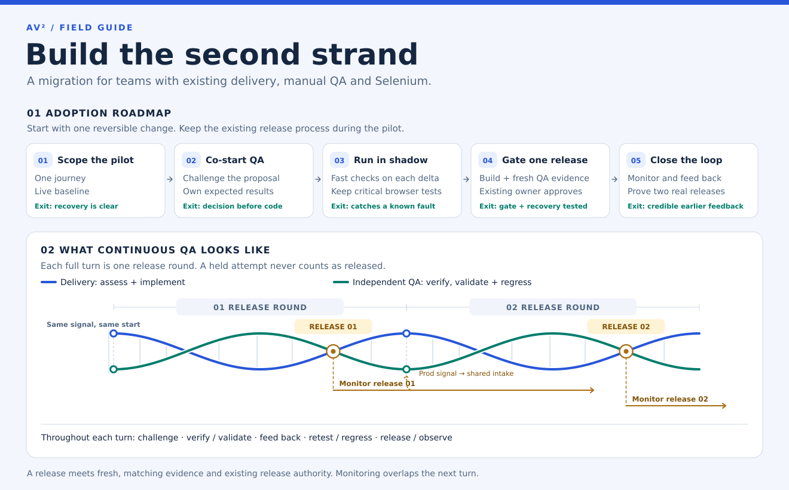

# AV² Adoption Guide: From late testing to continuous independent QA

**Companion to AV² v0.4 · A practical migration for an existing product team**

**Start on Monday:** pick one small, reversible change in one product journey. Assign a developer and a QA owner. Give them the same production observation at the same time. Before the first code delta, have QA challenge the proposal and write two independent acceptance examples. Keep the existing release process in place. The initial goal is to prove that the second strand can change a decision while the work is still in progress.



## 1. Pick a pilot and record the baseline

**Owner:** QA lead with the product and operations owners. Choose a journey that changes often enough to observe multiple real rounds, with safe test data, a measurable signal, a stable test environment and a way to disable the change. Avoid payment, irreversible migrations and sensitive data in the first pilot. Record the currently deployed version, how the team releases today, when QA first sees changes, which checks regularly fail or flake, and the last few relevant defects.

Inventory the manual and Selenium tests for that journey. Mark each **keep in browser**, **cover earlier at a smaller boundary**, or **keep as exploratory**. Keep the current browser suite and manual release safeguards for the pilot. Ask what each check proves before moving it.

**Exit:** one named business owner, builder, independent QA owner and release owner; one live baseline; one measurable outcome; one rehearsable recovery path. If the product has no timely, repeatable release process, start with staging. The development workflow and release cadence do not need to change to start the QA pilot.

## 2. Start both strands at the same event

**Trigger:** a new change request or confirmed telemetry signal. In the existing tracker, create a versioned **Change Unit**: ID, live baseline, observed problem and source, intended outcome, explicit invariants, related work, risk, owner and rollback plan. Add a QA assignment at the same moment as the delivery assignment; do not wait for a pull request. A tracker form plus versioned JSON or YAML is enough to start. [Full Change Unit example](examples/change-unit.json).

- **Delivery strand:** assess options, dependencies and scope. Implement through the team's existing human or AI-assisted workflow. Do not take extra deployment powers as part of the pilot.
- **Independent QA strand:** reproduce or challenge the signal, check the proposed change against product constraints and related in-flight work, and write its own expected results before the first applicable code delta. **Verification:** do the signal, assumptions and proposed contract satisfy the rules? **Validation:** would the change resolve the observed user problem? Flag unknowns for the accountable owner rather than marking them green.

One person can hold several roles in a small team, but the builder cannot approve their own critical QA evidence. Assign a reviewer from another team if needed. Protect QA-owned fixtures, assertions and gate rules from builder edits. The same AI model may assist both sides, but two prompts alone do not establish independence: separate evidence, permissions and review decisions. If the critical expected result cannot be derived independently, keep the human review.

**Exit:** at least one QA challenge or acceptance decision is recorded before the first applicable code delta. If QA finds a material conflict, narrow, resequence or hold that unit before coding the affected slice. Unrelated work continues.

## 3. Move feedback into CI, in shadow mode first

**Owners:** QA and CI maintainers. On each meaningful diff or new candidate, run the shortest relevant checks: static rules for the affected lines or diff, then unit/property/API/contract checks for the smallest executable boundary. Run the defect reproducer **and** the impacted regression set. Keep critical Selenium journeys in parallel for browser wiring and actual user behaviour. Put slower system, cross-browser, accessibility and exploratory checks on their own schedule or trigger; any evidence required by the release policy must still arrive before exposure.

Have QA publish results to the change, with a concrete expected/observed result, test or fixture link, and exact revision. Start with advisory results for normal candidates in **shadow mode**: compare AV²'s proposed verdict against the existing release decision. Make known severe findings visible immediately under the existing escalation process. Test the tests: a working fixture should pass; a deliberately faulty variant in a safe environment should fail for the expected reason. A green test with a weaker assertion is not stronger evidence.

**Exit:** walk one healthy and one faulty candidate through both strands. Show that QA catches a defect before the full UI suite, a correction does not conceal a separate regression, and the relevant checks rerun when the candidate changes. Record flake, missed defects and false blocks. If tests cannot distinguish good from bad, stay in shadow mode.

## 4. Add one release rendezvous, with a human release owner

**Owners:** QA owns the evidence; the existing release owner authorises exposure. The two strands meet once at the decision for this candidate. The artifact the builder presents and the evidence QA presents must reference the same changes and versions. CI can compute eligibility; the existing release owner remains accountable for the decision and any legitimate exception. No AI verdict grants deploy authority.

| At the rendezvous | Minimum for the pilot |
| --- | --- |
| Exact candidate | Link the Change Unit and live baseline, integrated revision and deployable artifact digest. |
| Independent evidence | Match the artifact/revision to the approved contract, test/fixture versions and applicable policy. Include confirmation and required regression, as well as UI/system evidence where required. |
| Release authority | Record allowed environment, scope, approver and window; confirm monitored rollout and rollback owner. |
| Missing, stale or failed evidence | Hold the affected unit or dependency group. A new revision, rebased dependency or changed expectation invalidates affected evidence. A previous green run cannot approve it. Keep unrelated work moving. |

**Exit:** in staging, demonstrate a pass, a block on stale or failed evidence, and the recovery path. Move one low-risk slice to bounded production exposure only under the team's existing approval and safeguards. Keep the policy simple: **eligible for release ≠ authorised to release**.

## 5. Close the loop and expand by evidence

**Owners:** operations and product, with QA checking signal integrity. For the first bounded release, define the behaviour to watch, the technical guardrail, its reviewer, fallback and the observation window in advance. Log the actual deployed version. If an operational guardrail is breached, pause exposure or roll back by the agreed rule. Distinguish a healthy rollout from proof of business value; the latter may need more time and a comparable cohort.

Monitoring continues while delivery and QA pick up another Change Unit together. A production finding becomes a new observation linked to the release that produced it. It may open or reprioritise work; it cannot authorise deployment. Later turns start from the latest live baseline. Already active units recheck only affected assumptions and evidence. **One completed turn equals one real release round.** A held attempt does not count. If the company releases weekly, the pilot starts at that cadence; no need to manufacture minute-by-minute releases.

**Exit:** complete two separately scoped release rounds, demonstrate ongoing observation overlapping the next round and turn a real signal or a clearly labelled drill into a traceable follow-up. Extend to a second journey only if the pilot reduces time to credible independent feedback without sacrificing detection or recovery. Automate low-risk release decisions later only within an explicit, separately approved mandate; leave uncertain, high-impact and exceptional decisions with people.

## Copy this into the first pilot ticket

```text
Change Unit: <ID> | live baseline: <version>
Observation + evidence link:
Intended user outcome and success measure:
Rules that must still hold; related in-flight work:
Delivery owner / independent QA owner / release owner:
QA-written acceptance example + counterexample:
Candidate artifact + exact revision; contract and test-set version:
Current QA decision (pass / hold / unknown) + evidence:
Approved rollout scope; monitor, stop condition and rollback owner:
Production result + follow-up Change Unit (if needed):
```

Fill in the first six lines during assessment, before the first relevant code delta. Update the remaining lines as evidence arrives. Link the ticket to the team's own CI, test runner and monitoring system; no platform migration is required to trial the model.

## What changes for the existing test team?

| Today | During the transition |
| --- | --- |
| Manual execution at the end | Review proposals and counterexamples at intake; own representative and negative examples; run exploratory testing where judgment matters. |
| Selenium as the default check | Retain key browser journeys. Move duplicates to API, contract or module checks **only** after proving equivalent detection. Keep UI-specific assertions in the browser. |
| Builder writes most checks | Keep developer tests. Independently maintained acceptance rules and regression evidence carry separate weight. |
| AI makes or updates test drafts | Use it first to propose coverage gaps and counterexamples. Review against independent expectations; never allow it to silently weaken an assertion, quarantine a failing critical check or override a hold. If the product itself uses nondeterministic AI, add versioned eval sets and human-calibrated criteria before relying on an automated score. |
| Release testing is a handoff | QA participates when work starts, sends findings while code is changing, checks evidence at release and validates production signals. |

**Measure during the pilot:** time from intake to first QA challenge, time from changed revision to an actionable finding, missed known/seeded faults, false blocks, and critical invariants with current independent evidence. Log the denominator and candidate boundary. Compare with the prior process on the same journey; review pilot cases individually instead of treating a small sample as proof. Ask **“What would have shipped under the previous decision, and why?”**

## Worked first turn: retry sends two confirmation emails

Fictional appointment site. **Observation:** the same booking retry can send two confirmations. **Proposal challenge:** stopping all same-customer repeats would also suppress legitimate separate bookings; check for an in-flight notification change that touches the same handler. **Contract:** a repeated request with the same key sends one email; a separate valid key sends its own email. QA records both expected behaviours before coding.

**While coding:** use a test sink, not real customer emails. The API test checks actual queued notifications, not just a success toast. Revision A sends two for a retry. Revision B fixes the retry but suppresses separate bookings. Revision C passes both cases plus the affected contract regression. Keep a Selenium smoke test for the customer-visible booking confirmation. At the rendezvous the current C artifact and QA evidence match; the release owner decides whether the approved bounded rollout can proceed. **In production:** monitor duplicate confirmations and watch for suppressed legitimate confirmations. A new discrepancy enters the next turn as an observation, with QA starting alongside assessment again.

Further reading: [AV² V&V matrix](IMPLEMENTATION-PLAN.md) · [AV² architecture](ARCHITECTURE.md) · [Selenium project guidance on when to use a browser](https://www.selenium.dev/documentation/test_practices/overview/). The exit criteria above are proposed pilot criteria, not evidence that AV² has been validated in a production company.
