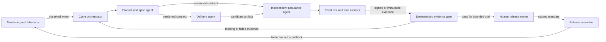

# AV² v0.1 · Agent architecture

Start with **one orchestrator, three specialist roles, a separate deterministic gate, and a named human release owner**. Roles can be separate jobs and credentials, not necessarily separate model vendors. Independence comes from what the builder cannot change.

| Role | Inputs and outputs | Permissions |
| --- | --- | --- |
| Cycle orchestrator | Creates a cycle from a human brief or monitor event; tracks dependencies and waits; sends only structured results to the gate. | Queue/state store only. No production credentials. |
| Product and spec agent | Turns documented observations into a hypothesis, stories, acceptance conditions and an Outcome Contract. Marks inferred or unknown facts. | Read permitted sources; propose spec changes. Cannot approve them or deploy. |
| Delivery agent | Reads contract; proposes code, preview and tests for developer feedback. | Writes the delivery branch. Cannot change assurance fixtures, the protected policy or deployment state. |
| Independent assurance agent | Reads contract and artifact; independently proposes scenarios, selects affected paths, invokes runners, and explains gaps with evidence links. | Separate CI identity. Read-only candidate access. New reference rules enter through a reviewed assurance path; scores are advisory. |
| Evidence gate / release controller | Gate checks exact artifact and policy revisions, required results, mandate scope and expiry. Controller executes canary, stops or rolls back within approved bounds. | Constrained service identity; no free-form deployment command from an LLM. New production authority requires a human. |
| Monitor and human owner | Monitor emits deduplicated, severity-classed events. Owner approves the initial scope, handles exceptions, retains stop control. | Monitoring reads limited telemetry; owner signs mandate. No automatic authority transfer to the next cycle. |

## What the QA AI actually does

1. **Trace:** map acceptance rules from the protected Outcome Contract to critical paths. Re-run affected coverage if the artifact, data source, prompt, model, skill or checker changed.
2. **Challenge:** produce positive, edge and fault-seeded scenarios from the spec before using implementation output as evidence. Quarantine checks with an ambiguous oracle. Never reclassify a missing mandatory result as not applicable.
3. **Run:** exact contracts, invariants and state checks first; browser E2E for journeys; repeated fixture-based evals with a fixed rubric for genuinely generative outputs. If using an LLM judge, check agreement against human-labelled anchors and route critical disagreements to a reviewer.
4. **Reconcile:** require a reference pass and a seeded-fault failure for critical assertions. Reject skipped or inconclusive critical checks. Keep the logs and an immutable record of which candidate, checker and fixtures ran.
5. **Explain:** show the owner what passed, what remains unknown, and the decision rule that applied. The AI provides the explanation; it does not override the rule or release its own work.

## Minimum records and states

- **Outcome Contract:** objective, population, baseline, metric, acceptance rules, non-goals, guardrails, owner and policy version.
- **Evidence record:** cycle ID, artifact SHA, contract/fixture/checker versions, result, runner identity, timestamp, reason and trace locator.
- **Release mandate:** approved artifact or explicitly bounded policy, named owner, rollout cap, window, stop thresholds, previous good artifact and revocation instructions.
- **Monitor event:** unique key, time, source, affected scope, severity and observed vs expected. Debounce and cap retries; budget exhaustion parks the cycle and alerts a human.
- **States:** INTAKE → SPEC → BUILD → ASSURE → APPROVAL → CANARY → MONITOR → NEXT INTAKE. Missing evidence → HOLD. Invalid mandate → REVIEW. Broken guardrail → ROLLBACK plus a new triage event.

This is a proposed architecture. The interactive demo is a deterministic simulation and does not connect to CI, production or an AI API.
