# AV²: Adaptive AI Verification & Validation

**v0.2 · Open RFC · Károly Kakocz**

An agent can misunderstand a business signal and carry the same mistake into the proposal, the implementation and its tests. In AV², independent assurance examines each artifact while it is being created. It starts with the first observation, not with the first completed build.

## What actually loops

1. **Observe and challenge.** An analyst proposes a change. Independently, QA verifies the signal and asks whether the proposed change would address the observed need.
2. **Partition and contract.** The planner emits versioned, machine-readable **Change Units**, not just prose tickets. QA reviews the boundaries and writes the independent acceptance examples before the first relevant code delta is available. Drafts can evolve, but the builder cannot quietly weaken approved expectations.
3. **Build and check concurrently.** A code delta triggers selected checks immediately. QA both verifies the delta against its contract and validates representative behaviour on the smallest useful executable slice. Feedback routes to the exact proposal, contract, context, code or test revision it challenges. Other unaffected units can continue.
4. **Admit evidence, not motion.** A candidate is eligible only when the current implementation and independently generated evidence agree. A valid release mandate still controls real exposure. Production observations queue new Change Units while existing ones are in progress; they do not grant new deployment authority.

**Verification** checks the artifact against requirements, contracts or rules. **Validation** checks fitness for the intended use. Before code, that means validating the *hypothesis or specification* against examples and observed needs, not claiming the product already works. After deployment, actual outcome validation needs appropriate data, often a control group and a longer observation window.

- [Implementation plan and detailed V&V matrix](IMPLEMENTATION-PLAN.md)
- [Event-driven agent and QA architecture](ARCHITECTURE.md)
- [Machine-readable worked example](examples/change-unit.json)
- [Interactive simulation](av2-loop.html): use **Download raw file**, then open locally. It autoplays, supports pause and single-step, and shows the independent QA verdict before the developer finishes. Try **Stale evidence** to see a blocked release without blocking the next discovery cycle.
- [Original discussion](https://github.com/kakoczkaroly/AV2-Adaptive-AI-Verification-and-Validation/discussions/1): opened against v0.1; this README describes the revised proposal.

This is a proposal and deterministic offline simulation, not a standard, benchmark result, live AI pipeline or permission to deploy. Background: [ISTQB CTFL: static and dynamic testing](https://istqb.org/wp-content/uploads/2024/11/ISTQB_CTFL_Syllabus_v4.0.1.pdf), [Google Cloud: early, parallel presubmit checks](https://docs.cloud.google.com/docs/cloud-approach-to-change), [NIST Generative AI Profile](https://doi.org/10.6028/NIST.AI.600-1). The proposed contribution is the combination of machine-readable change contracts, independent V&V at artifact level, and evidence invalidation and routing in a continuous adaptive loop.
