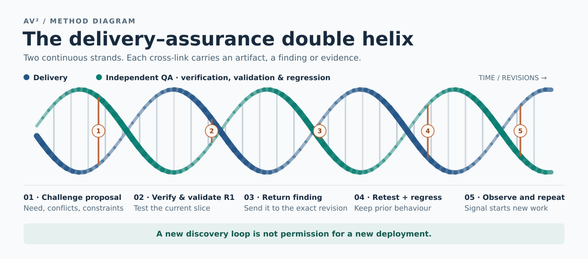

# AV²: Adaptive AI Verification & Validation

**v0.4 · Open RFC · Károly Kakocz**

An agent can misunderstand a business signal and carry the same mistake into the proposal, the implementation and its tests. In AV², independent assurance examines each artifact while it is being created. It starts with the first observation, not with the first completed build.

The **double helix** represents two independent but communicating loops: delivery and QA. Each cross-link is a versioned exchange: a proposal or change goes to QA; a finding or evidence goes back to the affected artifact. QA checks three separate things: **verification** (did we meet the rule?), **validation** (does this fit the need?), and **regression** (what already-correct behaviour must survive the change?). Regression is not a third strand or a final phase; its affected subset runs again on each relevant revision.

**Scale of the helix:** one full rotation represents one small release round, not the entire delivery process. Within each turn the five exchanges recur: challenge, verify and validate, feed back, retest and regress, and release within authority and observe. The overview shows six separately scoped successful releases, not six phases of one release. The delivery marker (assessment and implementation) and the independent QA marker both start from the same observation and last released baseline. They stay separate as they work and exchange evidence. At the **release rendezvous**, they converge on the same candidate in one decision: delivery brings the artifact and QA brings matching independent evidence. Authority is checked there. Monitoring then continues while the next round starts from the latest released baseline. The second apparent crossing in a drawn turn has no release meaning. Discovery for new work and monitoring of previous releases overlap. A held candidate is a blocked attempt, not a live release; unrelated rounds can continue.

## First decision: should this change be built at all?

A business proposal from a human or AI is a hypothesis. Independent QA can stop it before implementation if it contradicts the business objective, conflicts with queued or active work, or violates a known requirement. Unresolved evidence or policy applicability goes to the accountable owner; it does not silently pass. See the [proposal challenge and worked counterexample](PROPOSAL-CHALLENGE.md).

## What actually loops

1. **Observe and challenge.** An analyst proposes a change. Independently, QA verifies the signal and asks whether the proposed change would address the observed need.
2. **Partition and contract.** The planner emits versioned, machine-readable **Change Units**, not just prose tickets. QA reviews the boundaries and writes the independent acceptance examples before the first relevant code delta is available. Drafts can evolve, but the builder cannot quietly weaken approved expectations.
3. **Build and check concurrently.** A code delta triggers selected checks immediately. QA both verifies the delta against its contract and validates representative behaviour on the smallest useful executable slice. Feedback routes to the exact proposal, contract, context, code or test revision it challenges. Other unaffected units can continue.
4. **Admit evidence, not motion.** A candidate is eligible only when the current implementation and independently generated evidence agree. A valid release mandate still controls real exposure. Production observations queue new Change Units while existing ones are in progress; they do not grant new deployment authority.

**Verification** checks the artifact against requirements, contracts or rules. **Validation** checks fitness for the intended use. Before code, that means validating the *hypothesis or specification* against examples and observed needs, not claiming the product already works. After deployment, actual outcome validation needs appropriate data, often a control group and a longer observation window.

- [Adoption guide for existing teams](ADOPTION-GUIDE.md) · [Magyar összefoglaló](ADOPTION-GUIDE.hu.md)
- [Implementation plan and detailed V&V matrix](IMPLEMENTATION-PLAN.md)
- [Event-driven agent and QA architecture](ARCHITECTURE.md)
- [Machine-readable worked example](examples/change-unit.json)
- [Related work and what AV² proposes](RELATED-WORK.md)
- [Continuous release stream](av2-release-stream.html): six separately scoped turns with ongoing monitoring and an optional held round; the stream continues past turn 06. Use **Download raw file**, then open locally.
- [Inside one turn](av2-loop.html): use **Download raw file**, then open locally. It autoplays, supports pause and single-step, and shows the independent QA verdict before the developer finishes. Try **A fix introduces a regression** to see R2 fix the duplicate but break valid distinct requests, then R3 restore both checks. **Stale evidence** demonstrates that a blocked release does not block discovery.
- [Original discussion](https://github.com/kakoczkaroly/AV2-Adaptive-AI-Verification-and-Validation/discussions/1): opened against v0.1; this README describes the revised proposal.

This is a proposal and deterministic offline simulation, not a standard, benchmark result, live AI pipeline or permission to deploy. Background: [ISTQB CTFL: static and dynamic testing](https://istqb.org/wp-content/uploads/2024/11/ISTQB_CTFL_Syllabus_v4.0.1.pdf), [Google Cloud: early, parallel presubmit checks](https://docs.cloud.google.com/docs/cloud-approach-to-change), [NIST Generative AI Profile](https://doi.org/10.6028/NIST.AI.600-1). The proposed contribution is the combination of machine-readable change contracts, independent V&V at artifact level, and evidence invalidation and routing in a continuous adaptive loop.
