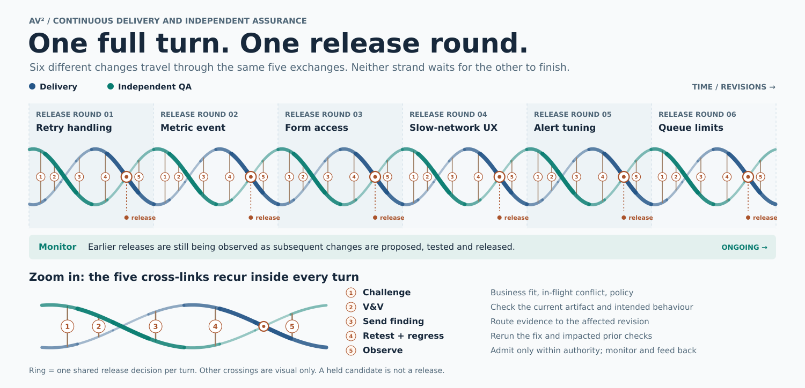

# AV² · Adaptive AI Verification & Validation

## What would make you trust a green build?

A patch fixes duplicate quote requests. The new test passes. The next patch stops counting legitimate requests, but CI still looks green because the QA suite silently dropped the check that could have caught it. **Who should be allowed to change the evidence that approves a release?**

**[Join the debate: what must independent QA own? →](https://github.com/kakoczkaroly/AV2-Adaptive-AI-Verification-and-Validation/issues/2)**  
Bring one counterexample, one missing signal or one reason the model would fail in your pipeline.

AV² is an **assurance layer for the delivery tools you already use**, whether the code is human-written, AI-generated or both. The same signal starts two strands: delivery proposes and implements a change; independent QA challenges it, checks its behaviour, and gathers evidence for the exact candidate. QA evolves too: a revised suite must catch new faults **without losing protection against old ones**.



## Try the prototype in one command

From a local copy, with Node.js 22+ and no dependencies:

```sh
node examples/quote-assurance.mjs
```

It runs a fictional quote-counting example: current evidence for the correct version is **eligible**; an injected functional defect and stale green evidence both **hold**. It also replays four QA suites on the same fixed product variants. Adding one good test while quietly removing a critical regression check fails the suite review.

| Where to start | What you'll find |
| --- | --- |
| [Framework](framework/README.md) | Local CLI, policy, report format and reproducible commands |
| [Docs](docs/README.md) | Model, adoption playbook, integration design and related work |
| [Visual demos](demos/README.md) | Six release rounds or a detailed view inside one turn |
| [Examples](examples/) · [Tests](tests/) | Versioned Change Unit example, runnable fixture and verification |

**What works now:** local report evaluation with a policy and versioned evidence, plus deterministic QA-suite replay.  
**What comes next:** a protected CI integration, followed by scoped adapters for the tracker, test runners and observability. AV² should take on routine QA work, not grant itself release authority, approve critical policy changes or replace accountable human review.

[Propose your first integration](https://github.com/kakoczkaroly/AV2-Adaptive-AI-Verification-and-Validation/issues/2) · [Explore related communities](docs/INTEGRATIONS.md#candidate-integration-points-not-affiliations) · [Original v0.1 discussion](https://github.com/kakoczkaroly/AV2-Adaptive-AI-Verification-and-Validation/discussions/1)

*Early prototype and open RFC by Károly Kakocz. No production connectors, live AI evaluation or deployment permissions are shipped.*
